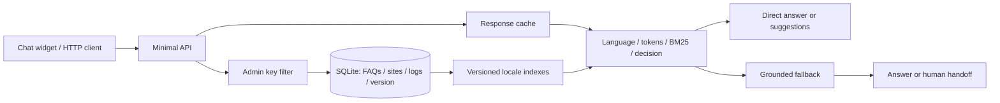

English | [繁體中文](README.zh-TW.md)

# Multilingual FAQ Help Center

A retrieval-first customer support service in Traditional Chinese, English, Korean, and Vietnamese, with grounded generation and a human handoff boundary.

## Background

Distilled from patterns I built and operated in production payment / membership platforms. This repository is a clean-room implementation with synthetic data.

## Features

- 20 synthetic Acme Store FAQs, each with four translations, alternate questions, and keywords.
- Script-based language detection, Unicode normalization, Chinese character conversion, CJK n-grams, Vietnamese accent variants, synonyms, and BM25.
- Direct FAQ answers, three candidate suggestions, grounded LLM fallback, and localized handoff messages.
- Versioned SQLite knowledge base, site switches, bounded response cache, diagnostics, and aggregate chat analytics.
- A floating chat widget with language selection, session storage, suggestion chips, and response-source badges. No external browser dependencies.
- A deterministic evaluator and 70 automated test cases, including isolated HTTP integration tests and stubbed external requests.

## Architecture



See [architecture diagrams](docs/architecture.md) for request sequences, decision flow, and the data model.

## Tech Stack

.NET 10 (SDK pinned in `global.json`), ASP.NET Core Minimal API, EF Core 10 with SQLite, Scalar API reference, plain HTML/CSS/JavaScript, xUnit, NSubstitute, and an in-process HTTP test host. Retrieval uses BCL code without a search server or tokenization package.

## Getting Started

Run commands from the repository root with the SDK specified in `global.json`:

```sh
dotnet restore FaqBot.slnx
dotnet run --project src/FaqBot.Api --no-restore
```

Open <http://localhost:5108> for the widget, <http://localhost:5108/scalar> for API exploration, or <http://localhost:5108/health> for liveness. The database directory is created on startup; seed FAQs are imported only when the FAQ table is empty. The default launch profile uses Development and a development admin key. No generation API key is required.

Container alternative:

```sh
docker compose up --build
```

The named volume persists `appdata`. Container hosting uses Production: admin routes deny access until `ADMIN_KEY` is set for Compose. Set a private value before using management endpoints. No key is placed in the image. The public demo remains usable without it.

Embed on a page served by the same origin:

```html
<script src="/widget.js" data-site="demo"></script>
```

The widget loads its stylesheet automatically. Cross-origin hosting requires an explicit CORS policy and is outside this demo.

## Configuration

Use environment variables with double underscores for nested keys, or edit the matching settings sections. Never store real keys in source control.

| Key | Default | Purpose |
| --- | --- | --- |
| `ConnectionStrings:FaqBot` | `Data Source=appdata/multilingual-faq-bot.db` | SQLite, relative to the process working directory |
| `Data:SeedPath` | `data/faq.seed.json` | Initial FAQ import; resolved from content root or repository root |
| `Data:SynonymsPath` | `data/synonyms.json` | Locale synonym groups, loaded when the index is rebuilt |
| `Retrieval:AnswerThreshold` | `0.62` | Minimum confidence for a direct answer |
| `Retrieval:SuggestThreshold` | `0.35` | Minimum confidence for suggestions |
| `Retrieval:MinMargin` | `0.08` | Minimum normalized gap for a direct answer |
| `Retrieval:K` | `4` | BM25 confidence calibration constant |
| `Llm:Provider` | `Auto` | `Auto`, `Gemini`, `Extractive`, or `Disabled` |
| `Llm:Gemini:ApiKey` | empty | Generation key; also accepts `GEMINI_API_KEY` |
| `Llm:Gemini:Model` | `gemini-2.5-flash` | Model identifier |
| `Llm:Gemini:Endpoint` | `https://generativelanguage.googleapis.com` | Configurable service base URL |
| `Admin:Key` | `dev-admin-key` in Development, empty otherwise | `X-Admin-Key` for every admin route |

`Auto` selects Gemini when a key is present and the offline Extractive implementation otherwise. Explicit `Gemini` without a key hands off; `Disabled` also hands off. Generation has an eight-second deadline, and caller cancellation is propagated. HTTP calls are never made by the offline implementation.

For example, in PowerShell before starting the service:

```powershell
$env:GEMINI_API_KEY = 'your-private-key'
$env:Admin__Key = 'your-private-admin-key'
dotnet run --project src/FaqBot.Api --no-restore
```

Sites `demo` and `docs` are enabled initially. Only `demo` enables LLM fallback. Site updates can change enablement, fallback, default-locale metadata, and localized handoff messages. Explicit locale hints take priority; otherwise detection uses the input script.

## API Walkthrough

Examples below use a POSIX shell and `curl`; use `curl.exe` in PowerShell, adapting line continuation and JSON quoting. No generation key is needed. [The request collection](src/FaqBot.Api/FaqBot.Api.http) includes all four languages and an import example.

```sh
# Direct FAQ answer
curl -s http://localhost:5108/api/chat -H 'Content-Type: application/json' \
  -d '{"siteCode":"demo","message":"How do I create an Acme Store account?","locale":"en","sessionId":"sample-session"}'
# Ambiguous question -> suggestions
curl -s http://localhost:5108/api/chat -H 'Content-Type: application/json' \
  -d '{"siteCode":"demo","message":"account","locale":"en"}'
# Unsupported question -> localized human handoff; docs has no generation
curl -s http://localhost:5108/api/chat -H 'Content-Type: application/json' \
  -d '{"siteCode":"docs","message":"Will it rain tomorrow?","locale":"en"}'
```

The first response has `source: "faq"`, `faqId: "account.register"`, the localized registration instructions, confidence, suggestions, and latency. The second has `source: "suggestions"` and up to three selectable questions. The third has `source: "handoff"` and asks the user to contact a human agent; it does not create a support ticket.

| Locale | Direct answer query (`demo`) | Suggestion query (`demo`) | Human handoff query (`docs`) |
| --- | --- | --- | --- |
| zh-TW | 如何註冊 Acme Store 帳號？ | 帳號 | 明天天氣如何？ |
| en | How do I create an Acme Store account? | account | Will it rain tomorrow? |
| ko | Acme Store 계정은 어떻게 만드나요? | 계정 | 내일 날씨는 어때요? |
| vi | Làm sao để đăng ký tài khoản Acme Store? | tài khoản | Ngày mai trời có mưa không? |

Use each row's locale value in the JSON request. Direct replies explain email verification in that language; suggestion replies ask the user to choose a related question; handoff replies ask them to contact support. These 12 examples were exercised against the HTTP service.

```sh
# Diagnostics and administrative reads
curl -s 'http://localhost:5108/api/chat/diagnose?q=refund&site=demo&locale=en' -H 'X-Admin-Key: dev-admin-key'
curl -s 'http://localhost:5108/api/faqs?locale=en&category=account' -H 'X-Admin-Key: dev-admin-key'
curl -s http://localhost:5108/api/faqs/account.register -H 'X-Admin-Key: dev-admin-key'
# Atomic upsert of the seed array; the next query sees a rebuilt index
curl -s http://localhost:5108/api/faqs/import -H 'X-Admin-Key: dev-admin-key' \
  -H 'Content-Type: application/json' --data-binary @data/faq.seed.json
# Disable / restore a site; a site update invalidates its cached responses
curl -s -X PUT http://localhost:5108/api/sites/demo -H 'X-Admin-Key: dev-admin-key' \
  -H 'Content-Type: application/json' \
  -d '{"siteCode":"demo","enabled":false,"llmFallbackEnabled":true,"defaultLocale":"en","handoffMessages":{}}'
curl -s -X PUT http://localhost:5108/api/sites/demo -H 'X-Admin-Key: dev-admin-key' \
  -H 'Content-Type: application/json' \
  -d '{"siteCode":"demo","enabled":true,"llmFallbackEnabled":true,"defaultLocale":"en","handoffMessages":{}}'
curl -s http://localhost:5108/api/sites -H 'X-Admin-Key: dev-admin-key'
curl -s 'http://localhost:5108/api/analytics/unanswered?days=7' -H 'X-Admin-Key: dev-admin-key'
curl -s 'http://localhost:5108/api/analytics/summary?days=7' -H 'X-Admin-Key: dev-admin-key'
```

`PUT /api/faqs/{id}` accepts one FAQ in the same format as an import array element, with an id matching the route and all four translations. `DELETE /api/faqs/{id}` sets `enabled=false`. Imports reject duplicate ids and invalid entries before writing. All knowledge-base writes increment a database version in the same transaction. Management errors return Problem Details with an extension named `code`. Public chat messages have a 2,000-character limit; analytics accepts 1–365 days.

A diagnostic response includes the following fields (scores are rounded here):

```json
{
  "normalized": "refund",
  "language": { "locale": "en", "confidence": 1 },
  "tokens": ["refund"],
  "expandedTokens": [{"text":"refund","weight":1},{"text":"money","weight":0.5},{"text":"back","weight":0.5},{"text":"reimburse","weight":0.5}],
  "bm25": [{"faqId":"refund.status","score":8.578,"matchedTokens":["refund","money","back"]}],
  "confidence": 0.648,
  "margin": 0.800,
  "decision": "Answer",
  "decisionPath": "Answer",
  "cacheHit": false
}
```

The actual candidate list contains up to ten results. `cacheHit` reports whether the corresponding chat request currently has an unexpired response, without generating or logging a chat.

## Design Decisions

1. **Retrieve before generating.** High-confidence queries return reviewed text locally, controlling cost, latency, and answer provenance. The index excludes FAQ answers, so long answers cannot overwhelm short question terms.
2. **Grounded fallback with an explicit refusal.** Only the top three translated FAQs enter the generation context. The system instruction treats user/context text as data, requires the user's language, and requests exactly `HANDOFF` when evidence is insufficient. Failures and timeouts produce a human handoff. This constrains answers but does not make a generative provider infallible.
3. **Portable lexical retrieval.** BM25 uses k1=1.2 and b=0.75, with keywords included twice. Chinese uses unigrams/bigrams; Korean uses words, simple suffix removal, and bigrams; Vietnamese uses syllables, adjacent syllables, and accent-free variants; English uses stopwords and light suffix rules. This avoids language packages and a search service, but lacks semantic understanding and sophisticated morphology.
4. **Confidence is a heuristic, not a probability.** Start with `top1/(top1+K)`, multiply by `0.75+0.25*margin`, then by query-term coverage. `margin=(top1-top2)/top1`; missing top2 means zero score. Synonym-only matched terms receive half credit toward coverage, capped at one. Coverage prevents a single common character from producing a confident unrelated answer. Direct answers also require the minimum margin.
5. **Versioned process-local caching.** The key is site, detected locale, normalized message, and database knowledge-base version. FAQ and site writes increment that version atomically. FAQ/suggestions expire after ten minutes, LLM replies after two, and handoffs/disabled replies are never cached. Every request, including a cache hit, gets a chat log. The cache clears at 1,000 keys; a restart loses only derived state.
6. **Site-level controls.** A disabled or unknown site returns `source=disabled`. Disabling fallback bypasses LLM calls. Sites share the same synthetic FAQ corpus; this is not isolated tenant storage or a real support platform. The admin key protects management and diagnostic routes; deployment needs its own transport, access, and retention policies.
7. **An offline alternative.** The Extractive provider quotes the highest-ranked FAQ when a candidate exists and its raw score is at least half the suggestion threshold; otherwise it hands off. It uses `source=llm` for the fallback branch and explicitly labels the text as an offline simulation. It is a lexical demonstration, not generated reasoning or a replacement for provider-quality evaluation.
8. **Measure before tuning.** The evaluator never invokes LLMs. Keep the dataset fixed, inspect misses using `--verbose`, then tune question variants, synonym groups, or confidence settings. Our 88 synthetic cases are a development set; use a separate, larger held-out corpus before drawing deployment conclusions. A low top-1 score or an out-of-scope fallback rate below 75% fails the tool.
9. **Simple persistence.** SQLite and startup schema creation keep the demo easy to run. There are no monetary columns. A future money column requiring SQL ordering or sums must use decimal in the domain and a scaled integer converter (×10⁴) in SQLite, because TEXT decimal comparisons are unsuitable and double would lose precision.

## Testing

```sh
dotnet build FaqBot.slnx --no-restore
dotnet test FaqBot.slnx --no-restore
dotnet run --project tools/FaqBot.Evaluator --no-restore -- \
  --dataset data/eval.jsonl --seed data/faq.seed.json --synonyms data/synonyms.json \
  --min-accuracy 0.8 --verbose
```

70 test cases cover normalization, detection, tokenization, synonyms, IDF ranking, confidence boundaries, orchestration, manual-time deadlines, cache invalidation/expiry, external HTTP request shape/parsing, management authorization, immediate import visibility, and evaluator metrics. Every HTTP integration case uses its own temporary SQLite database. External generation uses stub handlers, never real network requests.

Fixed dataset results: **100% top-1 accuracy (80/80)** and **100% out-of-scope Fallback (8/8)**, with 20 in-scope and two out-of-scope questions per locale. Answer precision and suggestion top-three inclusion are also 100% on in-scope cases. Empty metric denominators display as 0%. These are synthetic development results. The evaluator exits 1 below the accuracy target or a 75% out-of-scope fallback rate, and exits 2 on invalid input.

## Project Structure

```text
src/FaqBot.Core/           Models, language processing, search, decisions, orchestration, metrics
src/FaqBot.Infrastructure/ SQLite, indexing, caching, provider clients, DI
src/FaqBot.Api/            Endpoints, startup, settings, embedded widget
tests/FaqBot.Tests/       Unit and isolated HTTP integration tests
tools/FaqBot.Evaluator/   Offline evaluation CLI
data/                    Four-language FAQs, synonyms, fixed question corpus
docs/architecture.md     Component, sequence, flow, and data diagrams
```

## Roadmap

- Held-out multilingual evaluation, typo handling, richer morphology, and threshold calibration.
- Optional embeddings/vector search with the same grounded-answer boundary.
- Per-site knowledge isolation, stronger administrator identity, deployment rate limits, and log-retention controls.
- Real support-ticket integration, editorial workflow, and distributed cache invalidation.

## License

[MIT](LICENSE).
