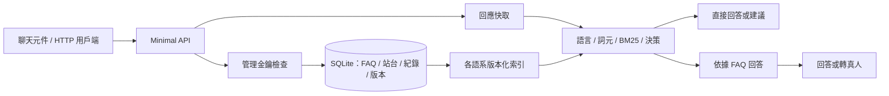

[English](README.md) | 繁體中文

# 多語系 FAQ 智能客服

[](https://github.com/Marc-YULIN/multilingual-faq-bot/actions/workflows/ci.yml)  

支援繁體中文、英文、韓文與越南文的客服服務，先檢索 FAQ，再依據知識庫生成回答，資訊不足時轉真人。

## 背景

萃取自我在正式環境付款與會員平台中建置、維運的設計模式。本專案採獨立重作，所有資料均為合成示範資料。

## 功能

- 虛構 Acme Store 的 20 題 FAQ，每題包含四語翻譯、替代問法與關鍵字。
- 依字元偵測語言，支援 Unicode 正規化、常見簡轉繁、CJK n-gram、越南文去聲調版本、同義詞及 BM25。
- 直接回答、最多三個建議問題、依據 FAQ 的 LLM 回答與各語系轉真人訊息。
- 版本化 SQLite 知識庫、站台開關、有容量上限的回應快取、診斷與聊天統計。
- 浮動聊天元件，含語言選單、工作階段儲存、建議按鈕及回答來源標籤，瀏覽器端不依賴外部套件。
- 可重現的評估工具與 70 個自動測試案例，包含獨立 HTTP 整合測試及外部請求替身。

## 架構



完整請求時序、決策流程與資料模型見[架構文件](docs/architecture.md)。

## 技術組合

.NET 10（SDK 由 `global.json` 固定）、ASP.NET Core Minimal API、EF Core 10 與 SQLite、Scalar API 文件、原生 HTML/CSS/JavaScript、xUnit、NSubstitute 及程序內 HTTP 測試主機。檢索以 BCL 實作，不需要搜尋伺服器或斷詞套件。

## 開始使用

安裝 `global.json` 指定的 SDK，從專案根目錄執行：

```sh
dotnet restore FaqBot.slnx
dotnet run --project src/FaqBot.Api --no-restore
```

開啟 <http://localhost:5108> 操作聊天元件、<http://localhost:5108/scalar> 檢視 API，或用 <http://localhost:5108/health> 檢查服務是否存活。啟動時會建立資料庫目錄，FAQ 資料表為空時才匯入種子資料。預設啟動設定使用開發環境與開發用管理金鑰，不需要設定生成服務金鑰。

也可用容器啟動：

```sh
docker compose up --build
```

命名磁碟區會保存 `appdata`。容器使用正式環境，必須設定 Compose 的 `ADMIN_KEY` 才能使用管理端點；請先設定私密值。映像不包含金鑰，未設定時仍可使用公開聊天示範。

同來源頁面可嵌入：

```html
<script src="/widget.js" data-site="demo"></script>
```

聊天元件會自行載入樣式。跨來源使用需另外設定明確的 CORS 政策，本示範未開放。

## 設定

巢狀設定可使用雙底線環境變數覆寫，或修改對應設定區段。不要將真實金鑰寫入版本控制。

| 設定鍵 | 預設值 | 說明 |
| --- | --- | --- |
| `ConnectionStrings:FaqBot` | `Data Source=appdata/multilingual-faq-bot.db` | SQLite，路徑相對於程序工作目錄 |
| `Data:SeedPath` | `data/faq.seed.json` | 初次匯入來源，從內容根目錄或專案根目錄解析 |
| `Data:SynonymsPath` | `data/synonyms.json` | 各語系同義詞群組，重建索引時載入 |
| `Retrieval:AnswerThreshold` | `0.62` | 直接回答最低信心值 |
| `Retrieval:SuggestThreshold` | `0.35` | 顯示建議最低信心值 |
| `Retrieval:MinMargin` | `0.08` | 直接回答所需最低正規化分差 |
| `Retrieval:K` | `4` | BM25 信心校準常數 |
| `Llm:Provider` | `Auto` | 可選 `Auto`、`Gemini`、`Extractive`、`Disabled` |
| `Llm:Gemini:ApiKey` | 空白 | 生成服務金鑰，也接受 `GEMINI_API_KEY` |
| `Llm:Gemini:Model` | `gemini-2.5-flash` | 模型識別碼 |
| `Llm:Gemini:Endpoint` | `https://generativelanguage.googleapis.com` | 可覆寫服務基底網址 |
| `Admin:Key` | 開發環境為 `dev-admin-key`，其餘空白 | 所有管理端點的 `X-Admin-Key` |

自動模式有金鑰時使用 Gemini，否則使用離線摘錄實作。明確指定 Gemini 但沒有金鑰時轉真人；停用生成服務也轉真人。生成請求期限為 8 秒，並傳遞呼叫者取消要求。離線實作不會送出 HTTP 請求。

例如在 PowerShell 啟動前設定：

```powershell
$env:GEMINI_API_KEY = 'your-private-key'
$env:Admin__Key = 'your-private-admin-key'
dotnet run --project src/FaqBot.Api --no-restore
```

預設建立啟用中的示範站台 `demo` 與文件站台 `docs`，僅示範站台開啟 LLM fallback。站台設定可調整啟用狀態、生成開關、預設語系中繼資料與各語系轉真人訊息。語言判斷優先採用有效提示，否則依輸入字元偵測。

## API 操作範例

以下範例使用 POSIX shell 與 `curl`。PowerShell 請用 `curl.exe`，並調整換行及 JSON 引號；不需要生成服務金鑰。[請求範例檔](src/FaqBot.Api/FaqBot.Api.http) 包含四語案例與完整匯入格式。

```sh
# 直接回覆 FAQ
curl -s http://localhost:5108/api/chat -H 'Content-Type: application/json' \
  -d '{"siteCode":"demo","message":"How do I create an Acme Store account?","locale":"en","sessionId":"sample-session"}'
# 問題過於籠統，提供建議
curl -s http://localhost:5108/api/chat -H 'Content-Type: application/json' \
  -d '{"siteCode":"demo","message":"account","locale":"en"}'
# 文件站台未開啟生成，範圍外問題轉真人
curl -s http://localhost:5108/api/chat -H 'Content-Type: application/json' \
  -d '{"siteCode":"docs","message":"Will it rain tomorrow?","locale":"en"}'
```

第一筆回應來源為 `faq`，FAQ 識別碼為 `account.register`，內容是該語系的註冊驗證步驟，另包含信心、建議與延遲。第二筆來源為 `suggestions`，附最多三個可選問題。第三筆來源為 `handoff`，請使用者聯絡真人客服；它不會建立客服工單。

| 語系 | 直接回答問句（示範站台） | 建議問句（示範站台） | 轉真人問句（文件站台） |
| --- | --- | --- | --- |
| zh-TW | 如何註冊 Acme Store 帳號？ | 帳號 | 明天天氣如何？ |
| en | How do I create an Acme Store account? | account | Will it rain tomorrow? |
| ko | Acme Store 계정은 어떻게 만드나요? | 계정 | 내일 날씨는 어때요? |
| vi | Làm sao để đăng ký tài khoản Acme Store? | tài khoản | Ngày mai trời có mưa không? |

將各列語系填入 JSON 的語系欄位。直接回答會以對應語言說明電子郵件驗證；建議回答請使用者選擇相關問題；轉真人回答請使用者聯絡客服。這 12 組範例已透過實際 HTTP 服務執行驗證。

```sh
# 診斷與管理查詢
curl -s 'http://localhost:5108/api/chat/diagnose?q=refund&site=demo&locale=en' -H 'X-Admin-Key: dev-admin-key'
curl -s 'http://localhost:5108/api/faqs?locale=en&category=account' -H 'X-Admin-Key: dev-admin-key'
curl -s http://localhost:5108/api/faqs/account.register -H 'X-Admin-Key: dev-admin-key'
# 原子匯入；下一次查詢重建索引
curl -s http://localhost:5108/api/faqs/import -H 'X-Admin-Key: dev-admin-key' \
  -H 'Content-Type: application/json' --data-binary @data/faq.seed.json
# 關閉與重新啟用站台；站台異動也使舊快取失效
curl -s -X PUT http://localhost:5108/api/sites/demo -H 'X-Admin-Key: dev-admin-key' \
  -H 'Content-Type: application/json' \
  -d '{"siteCode":"demo","enabled":false,"llmFallbackEnabled":true,"defaultLocale":"en","handoffMessages":{}}'
curl -s -X PUT http://localhost:5108/api/sites/demo -H 'X-Admin-Key: dev-admin-key' \
  -H 'Content-Type: application/json' \
  -d '{"siteCode":"demo","enabled":true,"llmFallbackEnabled":true,"defaultLocale":"en","handoffMessages":{}}'
curl -s http://localhost:5108/api/sites -H 'X-Admin-Key: dev-admin-key'
curl -s 'http://localhost:5108/api/analytics/unanswered?days=7' -H 'X-Admin-Key: dev-admin-key'
curl -s 'http://localhost:5108/api/analytics/summary?days=7' -H 'X-Admin-Key: dev-admin-key'
```

`PUT /api/faqs/{id}` 接受匯入陣列中單筆 FAQ 的格式，識別碼須與路徑一致，且必須提供四語翻譯。`DELETE /api/faqs/{id}` 將該題設為停用。匯入在寫入前拒絕重複識別碼與無效資料。所有知識庫異動會在同一交易中增加版本。管理錯誤使用 Problem Details，擴充錯誤碼鍵名為 `code`。聊天訊息最多 2,000 字，統計期間為 1–365 天。

診斷回應包含以下欄位（此處分數已四捨五入）：

```json
{
  "normalized": "refund",
  "language": { "locale": "en", "confidence": 1 },
  "tokens": ["refund"],
  "expandedTokens": [{"text":"refund","weight":1},{"text":"money","weight":0.5},{"text":"back","weight":0.5},{"text":"reimburse","weight":0.5}],
  "bm25": [{"faqId":"refund.status","score":8.578,"matchedTokens":["refund","money","back"]}],
  "confidence": 0.648,
  "margin": 0.800,
  "decision": "Answer",
  "decisionPath": "Answer",
  "cacheHit": false
}
```

實際候選清單最多十筆。快取命中欄位表示對應聊天請求目前是否有未過期快取；診斷本身不會生成回答或新增聊天紀錄。

## 設計取捨

1. **先檢索再生成。** 高信心問題直接使用已整理的答案，控制成本、延遲與內容來源。索引只含問題、替代問法及關鍵字，避免冗長答案主導問題用詞。
2. **依據知識庫回答並允許拒答。** 只將前三題的對應語系內容交給生成服務。系統規則把使用者輸入及內容視為資料，要求使用對應語言，資料不足時只輸出 `HANDOFF`。例外與逾時轉真人。此限制有助於收斂內容，但不能保證生成服務永不出錯。
3. **可攜式字面檢索。** BM25 使用 k1=1.2、b=0.75，關鍵字重複納入兩次。中文採單字與雙字片段；韓文採空白詞、簡單助詞移除及雙字片段；越南文採音節、相鄰音節及去聲調版本；英文採停用詞與簡單字尾處理。無須斷詞套件或搜尋服務，代價是沒有語意理解與完整詞形分析。
4. **信心值是啟發式指標。** 以 `top1/(top1+K)` 起算，乘上 `0.75+0.25*margin` 與查詢詞覆蓋率。分差為 `(top1-top2)/top1`，沒有第二名時以零分計算。同義詞命中以半權重補足覆蓋率，最高為一。覆蓋率避免僅有一個共通字就產生過度自信的回答；直接回答還須通過最低分差。
5. **快取納入版本。** 鍵由站台、偵測語系、正規化訊息及知識庫版本組成。FAQ 與站台設定異動都在交易中增加版本。FAQ 與建議快取十分鐘，LLM 回覆兩分鐘，轉真人及停用回覆不快取。每次請求包含快取命中都寫聊天紀錄。快取到 1,000 個鍵時清空，重啟只會失去可重建資料。
6. **站台層級控制。** 停用或未知站台回傳停用來源；關閉生成時直接略過 LLM。各站共用同一份合成 FAQ，未實作租戶資料隔離或真實客服系統。管理金鑰保護管理及診斷端點，部署時仍需規劃傳輸、存取及資料保存政策。
7. **離線替代實作。** 有候選 FAQ 且最高原始分數至少為建議門檻的一半時，摘錄最高分問題與答案，否則轉真人。此分支回傳 `llm` 來源，文字明確標示離線模擬。這是字面檢索示範，並非生成推理，也無法取代真實服務品質評估。
8. **以評估決定調整。** 評估工具不呼叫 LLM。固定題庫後，以詳細模式檢查錯誤，再調整替代問法、同義詞或信心設定。這 88 題是合成開發題庫；正式導入前應使用更大的獨立保留題庫。top-1 未達標或範圍外 Fallback 率低於 75% 時，工具會失敗。
9. **簡化持久化。** SQLite 與啟動建表讓示範容易執行。目前沒有金額欄位；未來若新增需在 SQL 排序或加總的金額，領域層使用 decimal，SQLite 以乘以 10⁴ 的整數轉換儲存。TEXT 不適合金額比較，double 則會損失精確度。

## 測試

```sh
dotnet build FaqBot.slnx --no-restore
dotnet test FaqBot.slnx --no-restore
dotnet run --project tools/FaqBot.Evaluator --no-restore -- \
  --dataset data/eval.jsonl --seed data/faq.seed.json --synonyms data/synonyms.json \
  --min-accuracy 0.8 --verbose
```

70 個案例涵蓋正規化、語言偵測、斷詞、同義詞、IDF 排序、信心邊界、聊天協調、手動時間逾時、快取失效及到期、外部 HTTP 請求格式與解析、管理驗證、匯入後立即可查，以及評估指標。每個 HTTP 整合案例使用獨立暫存 SQLite；外部生成皆以 handler 替身測試，不連真實網路。

固定題庫的 **top-1 準確率為 100%（80/80）**，**範圍外 Fallback 率為 100%（8/8）**。每語系各有 20 題範圍內與兩題範圍外；範圍內直接回答精確率與建議前三名包含正解的比例也都是 100%。指標分母為零時顯示 0%。這些是合成開發題庫結果。未達準確率門檻或範圍外 Fallback 率低於 75% 時回傳結束碼 1，輸入無效時回傳 2。

## 專案結構

```text
src/FaqBot.Core/           模型、文字處理、檢索、決策、聊天協調、評估指標
src/FaqBot.Infrastructure/ SQLite、索引、快取、外部服務、DI
src/FaqBot.Api/            端點、啟動、設定、聊天元件
tests/FaqBot.Tests/       單元測試與獨立 HTTP 整合測試
tools/FaqBot.Evaluator/   離線評估 CLI
data/                    四語 FAQ、同義詞、固定題庫
docs/architecture.md     元件、時序、流程與資料圖
```

## 後續方向

- 獨立多語系保留題庫、錯字處理、詞形分析與門檻校準。
- 在相同知識庫回答邊界內，加入選用 embedding／向量搜尋。
- 各站知識隔離、更完整的管理者身分、部署限流及紀錄保存控制。
- 真實客服工單串接、編輯流程與分散式快取失效。

## 授權

[MIT](LICENSE)。
