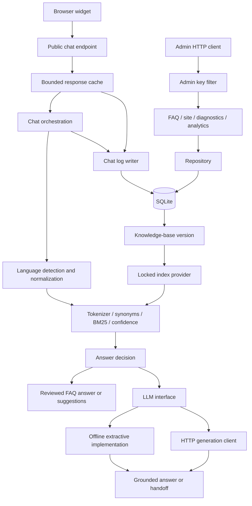
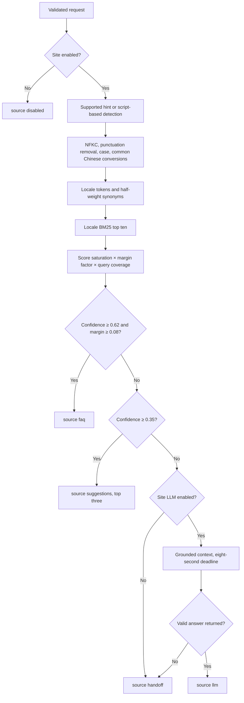
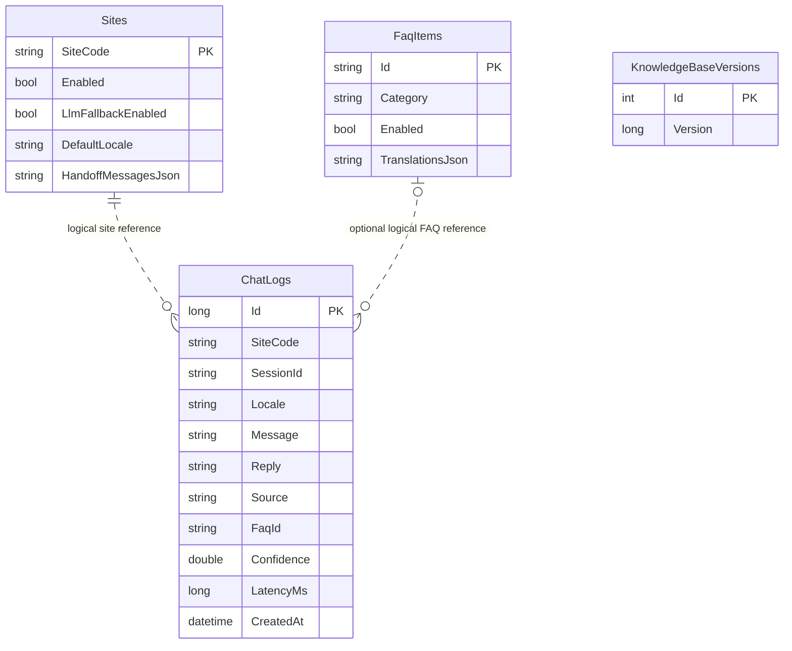

# Architecture

The service answers only from an enabled, versioned FAQ corpus. Four locale indexes share the same FAQ identities. Site settings control availability and fallback, while the knowledge base is shared across sites.

## Components and boundaries



Core contains models, interfaces, retrieval, orchestration, and evaluation calculations. Infrastructure contains SQLite persistence, HTTP, indexing, caching, and dependency registration. The API owns HTTP validation, management authorization, startup, and static assets. The evaluator uses the same retrieval engine without a database or generation calls.

## Chat request sequence

```mermaid
sequenceDiagram
    participant U as User / widget
    participant A as Chat API
    participant C as Response cache
    participant D as SQLite
    participant O as Orchestrator
    participant I as Index provider
    participant L as LLM client
    U->>A: site, message, optional locale/session
    A->>C: Handle request
    C->>D: Read knowledge-base version
    alt Unexpired matching cache key
        C->>D: Log this request and cached reply
        C-->>A: Cached content with current latency
    else Cache miss
        C->>O: Handle request
        O->>D: Read site setting
        alt Unknown or disabled site
            O->>D: Log disabled response
            O-->>C: source=disabled
        else Enabled site
            O->>I: Get locale indexes for current version
            I->>D: Check version; read FAQs on rebuild
            I-->>O: Search snapshot
            O->>O: Detect, normalize, expand, rank, score
            alt High confidence and sufficient margin
                O->>O: Return localized reviewed answer
            else Medium confidence
                O->>O: Return up to three suggested questions
            else Low confidence
                alt Site fallback enabled
                    O->>L: User question + top three FAQ contexts
                    L-->>O: Grounded reply / HANDOFF / error / timeout
                    O->>O: Reply or localized handoff
                else Site fallback disabled
                    O->>O: Localized handoff
                end
            end
            O->>D: Log final response
            O-->>C: Reply, source, locale, confidence, latency
        end
        C->>C: Cache faq/suggestions 10m, llm 2m; skip handoff/disabled
        C-->>A: Final response
    end
    A-->>U: JSON response
```

Generation has an eight-second deadline; caller cancellation propagates instead of creating an artificial handoff. The offline provider performs no HTTP calls and labels its fallback text as a simulation. A human handoff is a response state, not a ticket or external message.

## Decision flow



All thresholds are configurable. BM25 uses k1=1.2 and b=0.75; keywords appear twice in the document. The normalized margin is `(top1-top2)/top1`. Confidence starts as `top1/(top1+K)`, with K=4, then multiplies by `0.75+0.25*margin` and capped query coverage. Half-weight matched expansion terms can compensate for an unseen synonym. Zero hits yield zero confidence. These scores are ranking heuristics, not calibrated probabilities.

## Data model



The dotted references are logical associations, not enforced foreign keys: unknown-site requests are logged, and historical replies remain meaningful after FAQ changes. Translation JSON maps `zh-TW`, `en`, `ko`, and `vi` to question, answer, alternate questions, and keywords. The single version row is initialized at startup. FAQ and site writes atomically increment it; deletions are soft disables. Timestamps come from the injected clock and are persisted as UTC.

## Invalidation and operational boundaries

- Index snapshots are rebuilt under a semaphore after a version mismatch. Readers use immutable derived snapshots; a concurrent later mutation is noticed on the next version check.
- Response cache keys include site, detected locale, normalized message, and version. The cache is per process, has at most approximately 1,000 keys before clearing, and does not persist across restarts. Every hit still writes a log.
- The database persists FAQ/site data and full chat transcripts. A real deployment needs access controls, TLS, retention/deletion policy, and suitable backups. Shared FAQ storage does not provide tenant isolation.
- Admin routes require a configured key outside Development. Public chat does not require it. Error responses use Problem Details with a stable `code` extension; custom error logging records exception type without credential content.
- Startup uses schema creation rather than migrations. Future schema evolution needs a migration strategy. No monetary fields are present; future SQL-comparable monetary values must use a scaled integer representation, never double.
